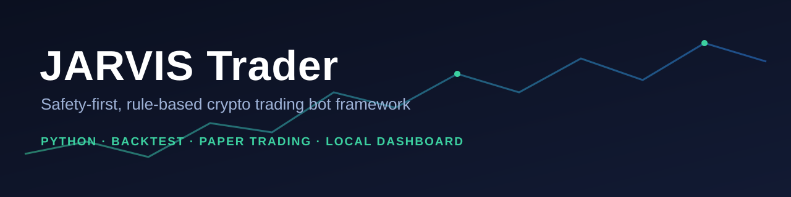

<p align="center">
  
</p>

# JARVIS Trader

A safety-first framework for **rule-based crypto spot trading** (no leverage). I built it to test trading
strategies on historical data, run them on paper money, and only move to real orders once the results prove
themselves — with hard risk limits that the code refuses to cross.

> 🇹🇷 Türkçe açıklama: [README.tr.md](README.tr.md)

## Why I built it

I wanted to know whether a simple, disciplined strategy could hold up over years of real price data, without
me watching a screen and without the temptation to override it. So the whole design is about *not* trusting
the bot blindly: every strategy is backtested, then paper-traded, and a weekly **control report** checks that
the live bots are still making the same decisions as the tested engine before any real money is allowed.

## What's inside

- **Two bot "team" strategies** that split the capital and each manage their own risk:
  - 🐢 **Turtle** — a 55/20-day breakout system with an ATR-based trailing stop.
  - 🏄 **Surfer** — a 50/200 EMA daily trend-following system.
  - A third **pullback** strategy (4h trend + 15m entry) is included for testing.
- **Backtesting engine** on free public price data (no API key needed to test).
- **Paper trading** that runs the exact same engine as a real account would.
- **Risk guardrails in code**, not just config: per-trade risk cap, daily-loss stop, max-drawdown brake, and
  a minimum order size. The config can make limits *stricter*, never looser than the hard ceilings.
- **Local web dashboard** (`127.0.0.1` only) to watch the bots, with a kill switch.
- **Control report**: are the live bots behaving like the backtest? Real-money mode stays locked until the
  reports come back consistent.

## ⚠️ Disclaimer

This software is provided **as is**, with no warranty, under the Apache 2.0 license. Trading crypto carries
real risk of losing money. Real-money mode ships **disabled** and requires three deliberate steps to enable.
You are responsible for anything you run with it.

## Screenshots

<!-- Drop a panel screenshot in screenshots/ (e.g. dashboard.png) and uncomment: -->
<!--  -->

## Running it

```bash
python jarvis.py durum        # show the active safety settings
python jarvis.py veri         # download historical price data (no key)
python jarvis.py test         # backtest the strategies
python jarvis.py rapor        # control report: do live bots match the backtest?
python jarvis.py ekip-test    # test the Turtle + Surfer team
python jarvis.py uygulama     # run both bots + dashboard
python -m unittest discover tests   # safety, engine, team and report tests
```

Secrets (exchange API keys) are **never** stored in the repo — they live in `%USERPROFILE%\.trader\`,
outside the project folder. The config file holds only non-secret settings.

## Emergency stop

Create an empty file named `DUR` in `%USERPROFILE%\.trader\` and the bots will stop opening trades.

## Tech

Python · ccxt-style exchange layer · SQLite state store · a small dependency-free HTTP dashboard.

## License

[Apache License 2.0](LICENSE) © 2026 Miraç Yusuf Y.
